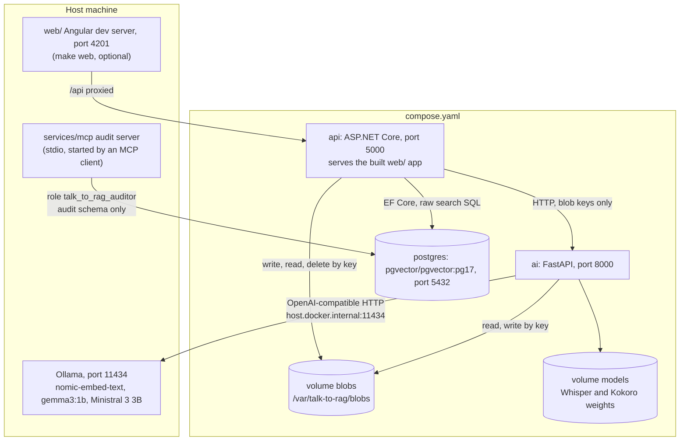
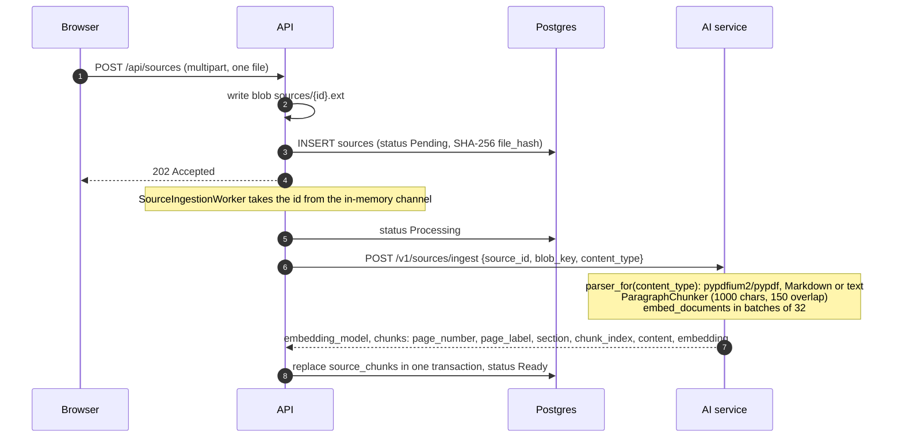
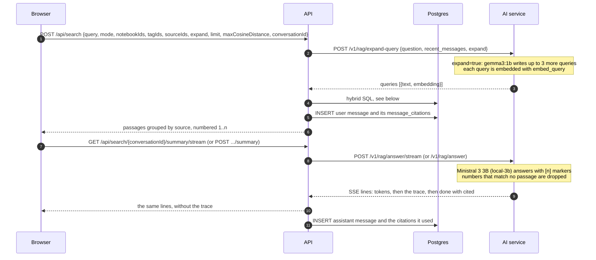
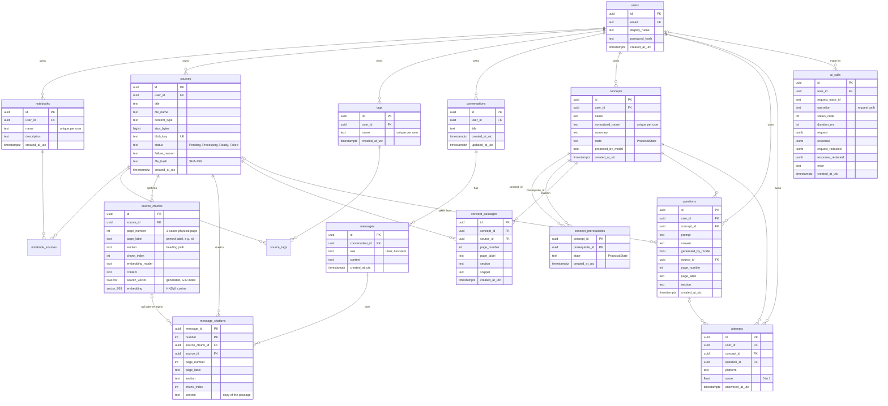

# Architecture

talk-to-rag answers one question first: which of my sources cover this, and where in them (source, page, section, snippet). A summary of the passages found, with numbered citations, follows: the web app shows the passages first and then streams the summary without being asked. Everything runs on one machine.

## Processes



- Every published port binds to 127.0.0.1.
- Ollama runs on the host because Docker on macOS has no GPU access.
- The API applies EF Core migrations on startup (`Database__MigrateOnStartup` in `compose.yaml`).
- The API image builds the Angular app in `web/` (a Node stage in `services/api/Dockerfile`, built from the repo root) and serves it from `wwwroot/`. The dev server (`make web`) is only for working on the app.
- `make eval` starts a second copy of the stack as compose project `talk-to-rag-eval`, with the API on port 5001 and its own volumes (`compose.eval.yaml`, `evaluation/run.sh`). `make test-e2e` does the same as `talk-to-rag-e2e` and runs the browser tests against the app that API serves.

## Files between the services

The API and the AI service share the `blobs` volume. The API sends the AI service a key, never the bytes. The C# `LocalBlobStorage` and the Python `LocalBlobStorage` must agree on what a key means.

| Key | Written by | Removed |
|---|---|---|
| `sources/{sourceId:N}.pdf`, `.md` or `.txt` | API, on upload | when the source is deleted |
| `audio/{userId}/{guid}.webm` (or `.ogg`, `.m4a`, `.mp3`, `.wav`) | API, before transcription | after transcription |
| `audio/{userId}/{guid}.wav` | AI service, on synthesis | after the API has streamed it |

## Ingestion



- Uploads accept `.pdf`, `.md` and `.txt` up to 200 MB.
- Markdown and text are one page: every chunk has `page_number` 1, and the section is the Markdown heading path.
- Each chunk stores the `embedding_model` the AI service reports, the id its provider knows the model by (`nomic-embed-text` for `local-embed`). A response without one fails the job.
- A failed job sets status Failed with a reason. If the source still has chunks from an earlier ingestion, it goes back to Ready with the reason set, so it stays searchable.
- On startup the worker queues every source still Pending or Processing.
- `POST /api/sources/{id}/retry` ingests any source that is not already Pending or Processing again. Citations in search history keep their copied text and location when the old chunks are replaced (`message_citations.source_chunk_id` is set to null).
- `DELETE /api/sources/{id}` removes the row, its chunks and its blob.

## Search and summary



The SQL in `SearchRepository`:

- runs `SET LOCAL hnsw.iterative_scan = relaxed_order` so a narrow scope still gets HNSW candidates;
- takes the top 50 chunks by cosine distance (`<=>`) for each query embedding, dropping any farther than the cutoff (default 0.6, `Search:MaxCosineDistance`);
- takes the top 50 by `ts_rank` on the generated `search_vector` column, where a chunk matches on any word of the question; a question with quotes or a leading minus uses `websearch_to_tsquery` instead;
- merges the lists with Reciprocal Rank Fusion, `sum(1 / (60 + rank))`, and builds snippets with `ts_headline`;
- filters every list on the user, `status = 'Ready'` and the allowed source ids worked out from the notebook, tag and source scope. Each kind of scope sent narrows the search: a source must be in one of the notebooks, carry one of the tags and be one of the source ids.

`mode` can be `hybrid` (default), `semantic` or `keyword`. `limit` is clamped to 1–50.

## Speech

- `POST /api/speech/transcribe`: the API writes the recording to an `audio/` key, the AI service transcribes it with faster-whisper (model `base`, CPU), and the API deletes the file. While the mic button is held, the web app sends the audio recorded so far to this route, one request at a time, to preview the words. The search runs on the transcription of the whole recording, made when the button is released.
- `POST /api/speech/synthesize`: the AI service speaks the text with Kokoro-82M (ONNX, voice `af_heart` by default) into a WAV under an `audio/` key. The API streams it back and deletes it. Text is limited to 5000 characters.
- `TALK_TO_RAG_STT=faster-whisper` and `TALK_TO_RAG_TTS=kokoro` turn these on; `compose.yaml` sets both. Without them the routes answer 503.
- The web app reads summaries aloud through `/api/speech/synthesize`, and use the browser's `speechSynthesis` only when that answers 503.

## Concepts and practice

- A `Concept` belongs to a user. `ConceptPrerequisite` rows ("understand B before A") make a graph, and `ConceptService` refuses an edge that would close a loop.
- Concepts and edges have a `ProposalState`. `POST /api/concepts/{id}/propose-prerequisites` asks `local-3b` (through `POST /v1/concepts/propose-prerequisites`) for proposals, which the user accepts, rejects, splits or relinks. Rejected rows are kept so they are not proposed again.
- `ConceptPassage` points at a source, page and section, not at a chunk id, because chunks get new ids when a source is ingested again.
- `POST /api/concepts/{id}/questions/generate` has `local-3b` write flashcards (`POST /v1/concepts/generate-questions`) from the text of the concept's passages.
- Every answer is an `Attempt` with a score from 0 to 1 (`POST /api/attempts`). Mastery is computed from attempts when read (`MasteryDto.From`): New with no attempts, Solid after at least 3 attempts with an average of 0.8 or more over the last 5, Learning otherwise.

## Audit log

- `AiAuditHandler`, a `DelegatingHandler` on the API's AI-service `HttpClient`, writes every request and response to `ai_calls`, once as sent and once redacted by `AuditJson`.
- A row's `user_id` is the signed-in user. Ingestion runs outside a request, so `SourceIngestionWorker` names the source's owner with `BackgroundAuditUser` around the call, and the handler uses that when there is no signed-in user.
- The AI service adds a `trace` list to its responses (`tracing.py`), one entry per model call with the messages and the completion.
- Redaction replaces passage text, and earlier answers sent as context, with a placeholder that gives the length. It also replaces any run of 40 or more letters and digits that a model reply copied from them.
- The `audit` schema holds views over the redacted columns and over the tables, without source text. The role `talk_to_rag_auditor` may only `SELECT` from it.
- `services/mcp` exposes that schema to an MCP client over stdio (`.mcp.json`) with the tools `describe`, `query` and `get_ai_call`. Each call opens a connection as the auditor role and runs in a read-only transaction that is rolled back.

## Code layout

```text
compose.yaml, compose.eval.yaml, Makefile
.github/workflows/ci.yml        runs make test on pushes to main and pull requests to main
evaluation/                     sample_questions.json and run.sh (make eval)
sample/                         four public-domain Markdown texts and load.sh (make sample)
services/
  ai/                           Python, uv, FastAPI
    config/models.toml          logical model names → Ollama models
    src/talk_to_rag/
      api/                      app.py, schemas.py, routes/ (health, ingestion, rag, speech, concepts)
      ingestion/                parsers (pypdf, markdown, text) and the paragraph chunker
      llm/                      ChatModel and Embedder, openai_compatible and fake adapters
      speech/                   faster-whisper, Kokoro and fake adapters
      storage/                  BlobStorage and LocalBlobStorage
      evaluation/               hit@k and MRR against the running API
      tracing.py                per-request record of model calls
  api/                          .NET 10, TalkToRag.slnx
    src/TalkToRag.Domain/          entities and enums
    src/TalkToRag.Application/     feature modules and ports (Common/Interfaces)
    src/TalkToRag.Infrastructure/  EF Core, search SQL, AI client, audit, worker, JWT, blob storage
    src/TalkToRag.Api/             controllers, Program.cs (serves the Angular build from wwwroot/ in the image)
    tests/TalkToRag.UnitTests, tests/TalkToRag.IntegrationTests (Testcontainers pgvector)
  mcp/                          read-only MCP server over the audit schema
web/                            Angular 22: sign-in, sources, search, history, concept graph
```

## Endpoints

API (`services/api`, all under `/api`; all but `health`, `auth/register`, `auth/login` and `auth/session` need a bearer token). An unknown path under `/api` is a 404. A GET for any other path without a file extension, such as `/history/{id}`, returns the web app's `index.html`, so the app's own routes work as links:

| Area | Routes |
|---|---|
| Health | `GET health` |
| Auth | `POST auth/register`, `POST auth/login`, `GET auth/session`, `GET auth/me` |
| Sources | `POST sources`, `GET sources`, `GET sources/{id}`, `GET sources/{id}/file` (also takes `?token=`), `POST sources/{id}/retry`, `DELETE sources/{id}` |
| Notebooks | `POST`, `GET notebooks`; `GET`, `PATCH`, `DELETE notebooks/{id}`; `PUT`, `DELETE notebooks/{id}/sources/{sourceId}` |
| Tags | `POST`, `GET tags`; `DELETE tags/{id}`; `GET sources/{id}/tags`; `PUT`, `DELETE sources/{id}/tags/{tagId}` |
| Search | `POST search`, `POST search/{conversationId}/summary`, `GET search/{conversationId}/summary/stream` |
| History | `GET conversations`, `GET conversations/{id}` |
| Speech | `POST speech/transcribe`, `POST speech/synthesize` |
| Concepts | `GET concepts/graph`, `POST concepts`, `GET`, `PATCH`, `DELETE concepts/{id}`, `POST concepts/{id}/accept`, `.../reject`, `.../split`, `.../propose-prerequisites`, `PUT`, `DELETE concepts/{id}/prerequisites/{prerequisiteId}`, `GET concepts/{id}/passage-suggestions`, `POST concepts/{id}/passages`, `DELETE concepts/{id}/passages/{passageId}` |
| Practice | `GET`, `POST concepts/{id}/questions`, `POST concepts/{id}/questions/generate`, `DELETE questions/{id}`, `POST attempts` |

AI service (`services/ai`): `GET /health`, `POST /v1/sources/ingest`, `POST /v1/rag/expand-query`, `POST /v1/rag/answer`, `POST /v1/rag/answer/stream`, `POST /v1/speech/transcribe`, `POST /v1/speech/synthesize`, `POST /v1/concepts/propose-prerequisites`, `POST /v1/concepts/generate-questions`.

## Database schema

Table and column names are snake_case (EFCore.NamingConventions). Rows owned by a user carry `user_id`, and another user's row answers 404.



The `audit` schema has views named `ai_calls`, `model_calls`, `answers`, `sources`, `chunks`, `messages`, `citations`, `concepts`, `concept_prerequisites`, `concept_passages`, `questions` and `attempts`, defined in the migrations under `services/api/src/TalkToRag.Infrastructure/Persistence/Migrations`.
