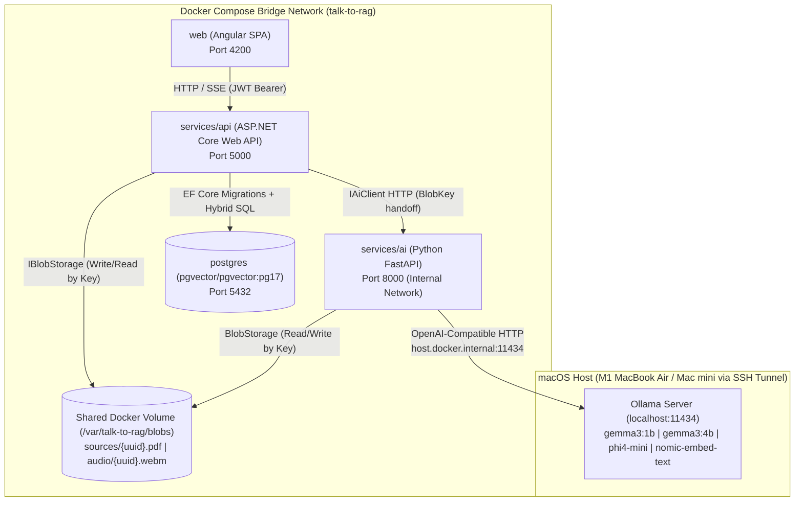
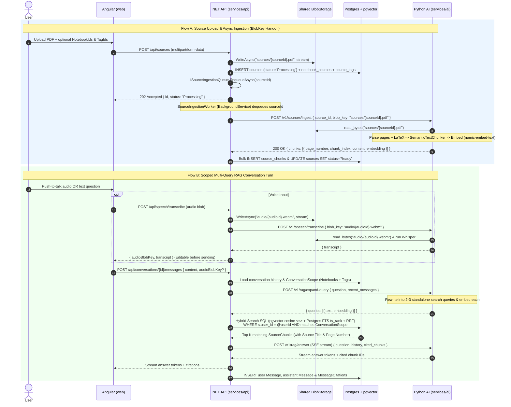
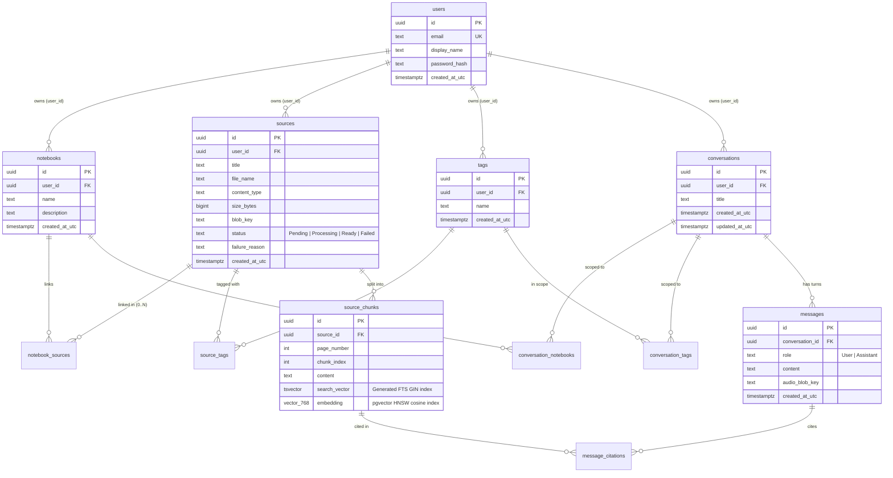

# `talk-to-rag` Architecture Blueprint & Implementation Plan

## Goal Description

`talk-to-rag` is a voice-enabled Retrieval-Augmented Generation (RAG) research and study platform designed around **Notebooks**, **Sources**, **Hybrid Search (`pgvector` + PostgreSQL Full-Text Search)**, and **Grounded Citations**.

**Product focus: sources first, retrieval first.** The main question the app answers is *which of my sources cover this, and where in them* (source, page, section, snippet). A model-written summary of the found passages is optional, layered on top. Chat is not the main screen.

It demonstrates a clean, polyglot enterprise architecture (**C# / ASP.NET Core**, **Python / FastAPI**, **Angular**, **PostgreSQL + `pgvector`**, and **Docker Compose**) with strict separation of concerns:
1. **Cross-Boundary Ports:** `IBlobStorage` / `LocalBlobStorage` (paired with Python `BlobStorage` / `LocalBlobStorage`), `IAiClient` / `HttpAiClient`, `ICurrentUser` / `ClaimsCurrentUser`, `ITokenGenerator` / `JwtTokenGenerator`.
2. **Domain Model (`TalkToRag.Domain`):**
   - **Root User-Owned Entities (carrying `UserId`):** `Notebook`, `Source`, `Tag`, `Conversation`.
   - **Child Entities (owned by parent FK):** `SourceChunk`, `Message`, `MessageCitation`.
   - **Many-to-Many Join Entities (`0..N`):** `NotebookSource`, `SourceTag`, `ConversationNotebook`, `ConversationTag` (wrapped in `ConversationScope`).
3. **Application, Ingestion & Persistence:** `ISourceIngestionQueue` + `ChannelSourceIngestionQueue` + `SourceIngestionWorker : BackgroundService`, `TalkToRagDbContext` (managing `HasPostgresExtension("vector")` directly in EF Core migrations), and feature modules (`Auth`, `Notebooks`, `Sources`, `Tags`, `Search`, `Conversations`).
4. **API Controllers (`TalkToRag.Api`):** `HealthController`, `AuthController`, `NotebooksController`, `SourcesController`, `TagsController`, `SearchController`, `ConversationsController`, `SpeechController`.
5. **Python Stateless AI Service (`services/ai`):** Capability modules `llm/`, `storage/`, `ingestion/`, `rag/`, `speech/`, `evals/`, and `api/` (`GET /health`, `POST /v1/sources/ingest`, `POST /v1/rag/expand-query`, `POST /v1/rag/answer`, `POST /v1/speech/transcribe`, `POST /v1/speech/synthesize`).

---

## System Architecture & Workflows

### Container & Process Topology (`compose.yaml` + Native Ollama)



### End-to-End Sequence Flows



---

## Monorepo Folder Structure & Naming Inventory

```text
talk-to-rag/
├── compose.yaml                                    # Postgres (pgvector:pg17), services/ai, services/api, web
├── Makefile                                        # make up, make down, make test, make migrate
├── README.md                                       # Architecture overview, quickstart, roadmap
├── .gitignore
├── docs/
│   └── architecture.md                             # Detailed system & RAG design notes
├── deploy/
│   └── terraform/                                  # Reserved for future Cloud (GCP/AWS/Azure) IaC
│
├── services/
│   ├── ai/                                         # Python 3.12+ Stateless AI Service (uv + FastAPI)
│   │   ├── Dockerfile
│   │   ├── pyproject.toml
│   │   ├── uv.lock
│   │   ├── config/
│   │   │   ├── models.toml                         # US-origin defaults (gemma3:1b, gemma3:4b, phi4-mini, nomic)
│   │   │   ├── models.local.example.toml           # Template for SSH-tunneled Mac mini / private hosts
│   │   │   └── models.local.toml                   # Gitignored machine-local overrides
│   │   ├── src/talk_to_rag/
│   │   │   ├── __init__.py
│   │   │   ├── api/
│   │   │   │   ├── __init__.py
│   │   │   │   ├── app.py                          # create_app() FastAPI factory
│   │   │   │   ├── schemas.py                      # IngestSourceRequest/Response, ExpandQueryRequest/Response, etc.
│   │   │   │   └── routes/
│   │   │   │       ├── __init__.py
│   │   │   │       ├── health.py                   # GET /health
│   │   │   │       ├── ingestion.py                # POST /v1/sources/ingest
│   │   │   │       ├── rag.py                      # POST /v1/rag/expand-query, POST /v1/rag/answer
│   │   │   │       └── speech.py                   # POST /v1/speech/transcribe, POST /v1/speech/synthesize
│   │   │   ├── llm/                                # Existing LLM & Embedder layer
│   │   │   │   ├── __init__.py
│   │   │   │   ├── __main__.py
│   │   │   │   ├── contracts.py                    # ChatModel, Embedder, Message, Role, ModelError
│   │   │   │   ├── config.py
│   │   │   │   ├── factory.py
│   │   │   │   └── adapters/
│   │   │   │       ├── __init__.py
│   │   │   │       ├── openai_compatible.py
│   │   │   │       └── fake.py
│   │   │   ├── storage/                            # Shared blob storage abstraction
│   │   │   │   ├── __init__.py
│   │   │   │   ├── contracts.py                    # BlobStorage Protocol, StorageError
│   │   │   │   └── adapters/
│   │   │   │       ├── __init__.py
│   │   │   │       └── local.py                    # LocalBlobStorage
│   │   │   ├── ingestion/                          # Source parsing & semantic chunking
│   │   │   │   ├── __init__.py
│   │   │   │   ├── contracts.py                    # SourceParser, TextChunker, ParsedPage, ChunkPayload, IngestionError
│   │   │   │   └── adapters/
│   │   │   │       └── __init__.py
│   │   │   ├── rag/                                # Query expansion & grounded citation generation
│   │   │   │   ├── __init__.py
│   │   │   │   ├── contracts.py                    # QueryExpander, AnswerGenerator, ExpandedQuery, CitedChunk
│   │   │   │   └── adapters/
│   │   │   │       └── __init__.py
│   │   │   ├── speech/                             # Whisper STT & Piper TTS
│   │   │   │   ├── __init__.py
│   │   │   │   ├── contracts.py                    # SpeechTranscriber, SpeechSynthesizer, SpeechError
│   │   │   │   └── adapters/
│   │   │   │       └── __init__.py
│   │   │   └── evals/                              # Retrieval evaluation (hit@k, MRR)
│   │   │       ├── __init__.py
│   │   │       └── contracts.py                    # RetrievalEvalCase, EvalMetrics
│   │   └── tests/
│   │       ├── test_llm.py
│   │       ├── test_storage.py
│   │       └── test_api_health.py
│   │
│   └── api/                                        # C# / ASP.NET Core Clean Architecture Solution
│       ├── Dockerfile
│       ├── TalkToRag.slnx                              # .NET 10 XML solution format
│       ├── src/
│       │   ├── TalkToRag.Domain/
│       │   │   ├── TalkToRag.Domain.csproj
│       │   │   ├── Entities/
│       │   │   │   ├── User.cs
│       │   │   │   ├── Notebook.cs
│       │   │   │   ├── Source.cs
│       │   │   │   ├── SourceChunk.cs
│       │   │   │   ├── Tag.cs
│       │   │   │   ├── NotebookSource.cs
│       │   │   │   ├── SourceTag.cs
│       │   │   │   ├── Conversation.cs
│       │   │   │   ├── ConversationNotebook.cs
│       │   │   │   ├── ConversationTag.cs
│       │   │   │   ├── Message.cs
│       │   │   │   └── MessageCitation.cs
│       │   │   ├── Enums/
│       │   │   │   ├── SourceStatus.cs             # Pending, Processing, Ready, Failed
│       │   │   │   └── MessageRole.cs              # User, Assistant
│       │   │   └── Exceptions/
│       │   │       ├── DomainException.cs
│       │   │       ├── NotFoundException.cs
│       │   │       └── ForbiddenAccessException.cs
│       │   │
│       │   ├── TalkToRag.Application/
│       │   │   ├── TalkToRag.Application.csproj
│       │   │   ├── DependencyInjection.cs
│       │   │   ├── Common/
│       │   │   │   ├── Interfaces/
│       │   │   │   │   ├── IBlobStorage.cs
│       │   │   │   │   ├── IAiClient.cs
│       │   │   │   │   ├── ICurrentUser.cs
│       │   │   │   │   ├── ITokenGenerator.cs
│       │   │   │   │   └── ISourceIngestionQueue.cs
│       │   │   │   └── Models/
│       │   │   │       └── ConversationScope.cs    # Wrapper: NotebookIds, TagIds, SourceIds lists
│       │   │   ├── Auth/
│       │   │   │   ├── AuthContracts.cs
│       │   │   │   ├── IAuthService.cs
│       │   │   │   └── AuthService.cs
│       │   │   ├── Notebooks/
│       │   │   │   ├── NotebookContracts.cs
│       │   │   │   ├── INotebookService.cs
│       │   │   │   └── NotebookService.cs
│       │   │   ├── Sources/
│       │   │   │   ├── SourceContracts.cs
│       │   │   │   ├── ISourceService.cs
│       │   │   │   └── SourceService.cs
│       │   │   ├── Tags/
│       │   │   │   ├── TagContracts.cs
│       │   │   │   ├── ITagService.cs
│       │   │   │   └── TagService.cs
│       │   │   ├── Search/
│       │   │   │   ├── SearchContracts.cs
│       │   │   │   ├── ISearchService.cs
│       │   │   │   └── SearchService.cs
│       │   │   └── Conversations/
│       │   │       ├── ConversationContracts.cs
│       │   │       ├── IConversationService.cs
│       │   │       └── ConversationService.cs
│       │   │
│       │   ├── TalkToRag.Infrastructure/
│       │   │   ├── TalkToRag.Infrastructure.csproj
│       │   │   ├── DependencyInjection.cs
│       │   │   ├── Persistence/
│       │   │   │   ├── TalkToRagDbContext.cs
│       │   │   │   ├── Configurations/
│       │   │   │   │   ├── UserConfiguration.cs
│       │   │   │   │   ├── NotebookConfiguration.cs
│       │   │   │   │   ├── SourceConfiguration.cs
│       │   │   │   │   ├── SourceChunkConfiguration.cs
│       │   │   │   │   ├── TagConfiguration.cs
│       │   │   │   │   ├── NotebookSourceConfiguration.cs
│       │   │   │   │   ├── SourceTagConfiguration.cs
│       │   │   │   │   ├── ConversationConfiguration.cs
│       │   │   │   │   ├── ConversationNotebookConfiguration.cs
│       │   │   │   │   ├── ConversationTagConfiguration.cs
│       │   │   │   │   ├── MessageConfiguration.cs
│       │   │   │   │   └── MessageCitationConfiguration.cs
│       │   │   │   └── Migrations/
│       │   │   ├── Storage/
│       │   │   │   └── LocalBlobStorage.cs
│       │   │   ├── Ai/
│       │   │   │   └── HttpAiClient.cs
│       │   │   ├── Ingestion/
│       │   │   │   ├── ChannelSourceIngestionQueue.cs
│       │   │   │   └── SourceIngestionWorker.cs
│       │   │   └── Security/
│       │   │       ├── ClaimsCurrentUser.cs
│       │   │       └── JwtTokenGenerator.cs
│       │   │
│       │   └── TalkToRag.Api/
│       │       ├── TalkToRag.Api.csproj
│       │       ├── Program.cs
│       │       ├── appsettings.json
│       │       ├── appsettings.Development.json
│       │       └── Controllers/
│       │           ├── HealthController.cs
│       │           ├── AuthController.cs
│       │           ├── NotebooksController.cs
│       │           ├── SourcesController.cs
│       │           ├── TagsController.cs
│       │           ├── SearchController.cs
│       │           ├── ConversationsController.cs
│       │           └── SpeechController.cs
│       │
│       └── tests/
│           └── TalkToRag.UnitTests/
│               └── TalkToRag.UnitTests.csproj
│
└── web/                                            # Angular SPA
    ├── Dockerfile
    ├── package.json
    ├── angular.json
    └── src/
```

---

## PostgreSQL Relational & Vector Schema (`TalkToRagDbContext`)



---

## Multi-Milestone Roadmap

| Milestone | Scope | Key Concepts |
|---|---|---|
| **Milestone 1** | Monorepo layout (`services/ai`, `services/api`, `web`), US-origin model config, Shared `BlobStorage`, Python FastAPI scaffold, .NET Clean Architecture + EF Core `pgvector` schema + JWT Auth, `compose.yaml` | Clean Architecture ports/adapters, `pgvector` HNSW indexes, Postgres `tsvector` GIN indexes, shared blob storage by UUID |
| **Milestone 2** | Source Upload (`POST /api/sources`), `SourceIngestionWorker`, Python PDF/Markdown parsing & semantic chunking (`POST /v1/sources/ingest`) | Chunk size & overlap trade-offs, preserving page citations & LaTeX equations, batch embedding |
| **Milestone 3** | Hybrid Search (`POST /api/search`) returning passages grouped by source with page/section locations, then an optional grounded summary of those passages (`POST /api/conversations/{id}/messages`, which also keeps the history of what was asked and found) | Cosine distance (`<=>`), Reciprocal Rank Fusion (RRF), multi-query expansion, pre-filtered `ConversationScope` (`Notebook` & `Tag` filters), grounded citation prompting |
| **Milestone 4** | Angular UI matching the sources-first prototype: Sources grid (file icon, name, description on hover), drag-and-drop upload and drag-to-notebook, top-centred view toggles (Sources / Results / History), floating search bar with a prominent push-to-talk mic, Results as passages with "open at page" links, optional summary with read-aloud (Whisper STT & Piper TTS) | Streaming SSE responses in Angular, browser `MediaRecorder` push-to-talk workflow, HTML drag and drop |
| **Milestone 5** | Automated Evaluation Suite (`hit@k`, `MRR`) + GitHub Actions CI | Golden Q&A dataset, retrieval recall (`hit@k`) and ranking quality (`MRR`), regression gating in CI |
